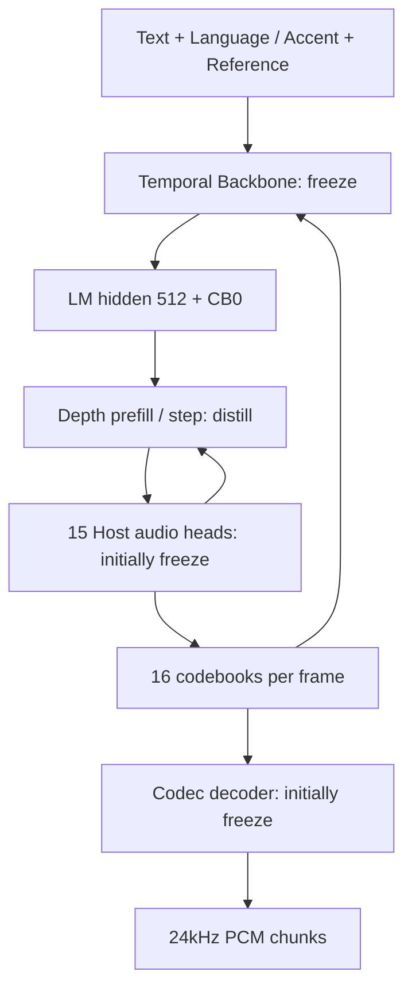

# M5-TTS-Lite：面向 AX650N 的小样本蒸馏与高速流式推理实施方案

> 版本：V1.0 | 2026-11-26  
> 基准：用户提供的 `distill_efficiency.md`（下称《实测报告》）  
> 目标：不重新预训练 TTS，以尽可能少的中英文数据继承原模型的能力，在 LITTLE 单 NPU 核、默认 OMP=1 的语音对话链路中降低 RTF 和 TTFA。  
> 证据标记：**[实测]** 来自用户报告；**[公开]** 来自官方公开资料；**[推算]** 基于已知数据的数学估计；**[建议]** 待实验确认的研发配置。本文未执行训练、编译或板端测试。

## 0. 执行摘要

**首选路线：冻结 Temporal Backbone、Codec Encoder/Decoder 和原始音频头，仅对 Depth Decoder 做结构化剪枝初始化 + 轨迹蒸馏；先用 1 小时数据打通流程，3 小时验证可行性，10 小时作为第一轮正式训练上限。达到验收门槛即停止扩大数据。**

| 决策项 | 首版选择 | 原因 |
|---|---|---|
| Teacher | 与当前部署同源的浮点 M5-TTS checkpoint | 防止不同版本、词表或 GRPO 配置造成比较失真 |
| Student | Depth-S：3 层、hidden 512、FFN 1024，注意力配置先继承教师 | 降低权重读取，保留接口；不重新学习文本到语音 |
| 训练范围 | 只更新 Depth，随后独立做 Host 头低秩压缩 | 尽量降低小样本能力遗忘 |
| 数据 | 10h 封顶：6h 中文、3h 英文、1h 中英混读；先使用嵌套 1h/3h 子集 | 10h 已含 45 万帧、675 万个局部码本监督位置 |
| 部署 | AX650N LITTLE 0x2，NPU1，U16 激活 / S8 权重，OMP=1 主验收 | 与实际语音链路一致，不依赖增加核数或 CPU 线程 |
| 第一目标 | OMP=1 短句 RTF ≤0.55，OMP=8 ≤0.36，质量门禁通过 | 对应现有基线 0.68/0.49 |
| 第二目标 | 分组 Depth + 低秩头，OMP=1 RTF ≤0.40–0.48 中的 0.48 上限 | 结构级加速与 Host 优化并行，逐项实测 |
| 第三目标 | Codec 压缩仅在确认为下一瓶颈后启动 | 波形重建难度更高，不应提前消耗训练数据 |

不建议第一轮直接从头训练 2M Codec、全并行预测 15 个码本、压缩 LM 或下载数百小时语料。上述目标不保证仅靠 10h 即可实现，是否扩充数据取决于独立验证集结果。

## 1. 原始模型及实际部署结构

### 1.1 公开架构与本地实现的边界

[公开] M5-TTS 50M 的语言生成部分由约 30M Temporal Backbone 和约 20M Local/Depth Decoder 构成，Codec 不计入 50M。每秒生成 12.5 个声学帧，每帧 16 个码本，输出 24kHz 音频。Backbone 预测 CB0，Depth 预测 CB1–CB15。官方当前主页面提供 SFT/CPT 和 GRPO 训练入口，普通初始化要求 teacher/student flavor 结构匹配，因此结构剪枝后的权重迁移需自定义。[1][2]

[实测] 本地部署不是官方 CPU benchmark：Depth 为 5 层、hidden 512，分为 `depth_prefill` 与 `depth_step` 图，15 个局部音频头在 Host 执行 int8 GEMV，S8 Depth 编译图约 20.5MB。每帧有 14 次 `depth_step`，另有 prefill。**CB1–CB15 共 15 个预测位置不等于 15 次 step。** 原报告注明 prefill “仅首帧 2 token”，但与每帧重置局部 KV 的常见实现之间存在待核实点；不得自行假设它每帧调用或仅全句调用。



必须核查实际回灌路径：完整 16 码本的帧 embedding 会影响下一帧 Temporal Backbone。因此即使冻结 LM，Depth 的错误也可能跨帧累积，并不意味着语言能力天然完全保留。

### 1.2 固化性能基线 [实测]

| 条件 | 短句 3.52s（44帧） | 长句 8.24s（103帧） |
|---|---:|---:|
| warm / OMP=1 | 2.38s / RTF 0.68 | 5.47s / 0.66 |
| warm / OMP=8 | 1.73s / 0.49 | 3.96s / 0.48 |
| warm / OMP=2、4 | 1.99s / 0.57；1.80s / 0.51 | 未提供 |
| cold reference / OMP=1 | 4.14s / 1.18 | 未提供 |
| cold reference / OMP=8 | 约 2.26s / 0.64 | 未提供 |
| Codec NPU1 / OMP=8 | 0.380s | 0.884s |
| Codec NPU3 对照 | 0.178s | 0.414s |

环境：AX650N、8×A55，BIG_LITTLE、`AX_ENGINE_SetAffinity(0x2)`，全部模型串行、参考缓存命中、固定文本和 seed。Cold 指参考音色缓存未命中，并不必然代表进程/模型加载冷启动；两者应另行统计。

### 1.3 瓶颈及优先级 [实测 + 推算]

| 模块 | 原报告每帧名义流量 | 原报告耗时 | 处理策略 |
|---|---:|---:|---|
| Depth step | 14×20.5=287MB | 25.2–32.2ms（14×1.8–2.3） | P0：缩小模型、减少调用 |
| Host 15 heads | 15.7MB | 17ms（OMP1）/2.5ms（OMP8） | P0b：低秩/向量化，OMP1 场景收益高 |
| Codec decoder | 133/8=16.625MB | 短句 380ms/44=8.64ms 摊薄 | P1：后续压缩、chunk 优化 |
| LM decode | 33MB | 约 6ms | P2：冻结，暂不蒸馏 |
| Reference RVQ | 一次性 | cold OMP1 enc 1.45s | 独立优化，不影响 warm RTF |

关键不是参数量本身，而是**每帧权重读取 × 串行次数**。原报告的 359MB/帧包含 Host 头/投影/状态搬运，287/359≈80%；仅按表中 NPU 三类权重估算，287/(287+33+16.625)≈85.3%。这是名义字节模型，不是硬件 DDR 计数器实测；实际读量受片上复用、权重压缩、图布局及 DMA 影响。

### 1.4 原报告中需要统一的计算口径

| 事项 | 修正或待确认 |
|---|---|
| 算术强度 | 287M MAC/287MB≈1 MAC/B；若 1 MAC=2 ops，则约 2 ops/B，不是 0.5 FLOP/B。INT8 使用 OP/s 比 FLOP/s 更准确。仍支持低算术强度假设，但需硬件计数器验证。 |
| 理论计算下界 | 574M ops / 1.2 TOPS≈0.478ms（假设 1.2 TOPS 且计数口径一致）；不是实际 latency。 |
| 帧数 | 10h=450,000帧；50h=2,250,000帧，不是 10–50 万帧。 |
| 低秩头 | 15×(512×64+64×2051)=2,460,480 权重，约 2.46MB S8（不含 scale/bias/padding）。 |
| RVQ MAC | 16×2048×60×256≈503M MAC，源报告 1.45s 与 0.2s 的分项需重新打点，避免重复计入。 |
| 每帧耗时闭合 | OMP8 短句 1.73s/44≈39.32ms；原报告各模块名义耗时相加约 42ms 或更高，不能直接相加预测。必须使用同次运行、同一计时边界的 profile。 |
| Codec 调用 | 44 帧按 8 帧 chunk 为 6 次（若末块补齐），103 帧为 13 次；实际次数由调度和 flush 决定。133/8 为稳态近似。 |
| 带宽 | 20.5MB/1.8ms≈11.4GB/s 只是名义权重/耗时；不是 DDR 带宽实测。 |
| 词表 | 实际 RVQ ID 0–2047 与模型音频词表 2051（包含特殊符号）不同；具体 offset/EOS/mask 从 checkpoint 和代码核对。 |

## 2. 研发路线：从小改动到结构级提速

| 阶段 | 实验 | 学习数据上限 | 结束条件 |
|---|---|---:|---|
| E0 | 原图复现、随机权重候选图、验证计数与调用契约 | 0h（可用现有测试样本作校准） | 确认板端更快，否则不训练 |
| E1 | 5→4 层及 5→3 层，原 FFN 不变，继承权重 | 1–3h | 确认最小变更可蒸馏恢复 |
| E2 | Depth-S 3层/512/FFN1024，logit KD | 3–10h | 首版质量/RTF 门禁通过即停止扩数据 |
| E3 | Host 头 SVD rank128→96→64，logit KD | 复用 E2 | OMP1 实测加速且质量通过 |
| E4 | CB 分组 8组→4组，逐步并行 | 复用10h，必要时20–50h | 达标才继续缩短串行链 |
| E5 | Codec 结构剪枝/蒸馏 | 10–30h PoC，必要时增量 | Codec 成为新瓶颈才开展 |
| E6 | LM 压缩、NAR、8-codebook | 单独立项 | 不作为小样本首版范围 |

E3 可以与 E1/E2 并行做独立 A/B，但组合前要验证交叉影响。E4 需要改 runtime 协议，而 E1/E2 主要改 KV 形状。E5 保持 16 码本及采样率不变。

## 3. 数据：尽可能少的中英文数据

### 3.1 为什么不需要复现 40 万小时

[公开] 原 M5-TTS 基础预训练约 40 万小时，数据来自 Emilia、Emilia-YODAS、WenetSpeech 系列及自有语音，继续预训练使用约 6.5 万小时的筛选子集。[1] 这些数据用于建立完整语言、韵律、说话人能力。本项目仅学习已训练 Teacher 的局部条件分布 `p(CB1:15 | LM_hidden, CB0, previous_codes)`，无需从头学习文本到声学映射。**小样本蒸馏是一种局部函数逼近，不是重新训练 TTS。**

10h 只有 45 万帧，却能提供 675 万局部码本监督位置；这些位置有相关性，不能等同于 675 万条独立语句。训练质量主要取决于上下文、声学及说话人覆盖，不能仅用 Token 数保证泛化。

### 3.2 第一批数据配比（训练集，累计小时）[建议]

| 语言 / 来源 | 1h PoC | 3h | 10h 正式 | 选取规则 |
|---|---:|---:|---:|---|
| 中文 AISHELL-3 或已授权多音色录音 | 0.3 | 0.9 | 3.0 | 不少于多个男女说话人，干净朗读 |
| 中文真实对话/已授权领域语音 | 0.2 | 0.6 | 2.0 | 短问答、数字、设备指令 |
| 中文 Teacher 生成困难文本 | 0.1 | 0.3 | 1.0 | 多音字、变调、连续数字、长句 |
| 英文 LibriTTS(-R) 或已授权录音 | 0.2 | 0.6 | 2.0 | 多说话人、英美口音、清晰朗读 |
| 英文 Teacher 生成领域文本 | 0.1 | 0.3 | 1.0 | 缩写、日期、单位、口语 |
| 中英混读（已授权语料或 Teacher 生成） | 0.1 | 0.3 | 1.0 | 产品名、Wi-Fi、数字与英文夹杂 |
| 合计 | 1 | 3 | 10 | 6h 中文 + 3h 英文 + 1h 混读 |

- 原则：1h ⊂ 3h ⊂ 10h；先抽样后提轨迹，不下载全库。上表小时指实际有效语音，不是原始下载量；每段配额可小幅调整并记录。
- 如果现有链路语料已授权、质量足够，优先复用，不必新下载。Teacher 生成数据使用有权限的参考音色；生成样本必须 ASR/听测过滤，避免把教师错音固化。
- 真实录音训练路径约占 70%，生成或混读部分约 30%（混读来源可为真实语音）。实际训练可按 70:30 混合真实 teacher-forced 与 free-running 帧，必要时调整，而不是把两类简单等同于原始音频来源。
- 选 30–60 个训练说话人作为首轮目标，中文/英文均有男女、语速和音高覆盖；若产品固定音色，可进一步缩至 5–10 个有授权的目标音色，但不能声称通用零样本能力保持。
- 先按说话人/会话/来源分组划分，再按语言采样；不允许同一原始长录音切片跨 train/val/test。重复文本、参考音色、合成 seed 也做去重/隔离。

### 3.3 独立验证、测试与校准

| 集合 | 建议规模 | 配置 |
|---|---|---|
| Validation | 0.5h | 中0.3h、英0.15h、混0.05h；不参与参数更新 |
| Test | 1h 或约 500 条独立 prompt | 中300、英150、混50；独立说话人/文本，短中长分层，含至少 30 条长文本 |
| PTQ calibration | 256–512 帧起步 | 从训练集独立留出片段/轨迹；覆盖 prefill、14 step 位置、静音/高能量、不同码本与学生自身回灌 |
| Board regression | 30–60 条 | 固定原报告两条中文基准，再加入英文、混读、不同参考音色及 cold/warm |

Test 以完整句子质量为主，训练可在得到完整 LM 上下文后以单帧独立采样。先确认 depth 是否在帧间清空 KV；若不清空，必须按真实上下文构造训练序列。验证/校准/测试不计入训练 10h。Seed-TTS Eval 可作为额外公开评测，仅测试不用来选训练样本。[8]

### 3.4 数据下载与授权

| 数据 | 入口 | 用途与许可注意 |
|---|---|---|
| AISHELL-3 | https://www.openslr.org/93/ | 中文高质量多说话人；官方标 Apache-2.0 [3] |
| LibriTTS | https://www.openslr.org/60/ | 英文 24kHz 朗读；官方标 CC BY 4.0 [4] |
| LibriTTS-R | https://www.openslr.org/141/ | 英文质量增强版本，下载前复核该版本许可及来源 [5] |
| WenetSpeech4TTS Premium | https://huggingface.co/datasets/Wenetspeech4TTS/WenetSpeech4TTS | 945h 优质中文；卡片虽提 CC BY 4.0，但明确非商业用途，不直接进入商用训练 [6] |
| Emilia | https://huggingface.co/datasets/amphion/Emilia-Dataset | 中英自然语音，CC BY-NC 4.0，仅非商业用途 [7] |

研究与商用产物分开管理，下载/使用前核对模型、Tokenizer、语音数据以及说话人授权；记录来源、许可、版本、哈希、归属标注。禁止使用许可不明的克隆音色。原始训练数据精确语言配比未获得，不是本方案输入条件。若需要真实数据做中英混读而没有授权来源，可仅用许可合规的 Teacher 生成轨迹先跑 PoC。

### 3.5 预处理规范

- 音频：按原 Codec 约定重采样到 24kHz，mono，float32 内部处理，PCM16/FLAC 原始存储；避免对每句无条件峰值归一化改变音色/响度。
- 切分：通常 2–12s/条，保留自然停顿；另保留 15–60s 长句和 1–2s 短指令。不要裁掉自然呼吸、弱音和 EOS 附近。
- 文本：保存原文与模型实际 normalizer 后文本；中文数字、多音字、中英混读不手动错误替换；保持 Teacher 原有 accent/lang/speaker prompt 规则。
- 过滤：严重削波、多人重叠、明显音乐、错误转写、失败 Codec 编解码；真实录音用 ASR 对齐辅助过滤，困难发音由人工复核。
- 分层：说话人、语言、句长、语速、信噪/音量、码本分布；按类别/语言选择难样本，不按全局 KL 单一排序。
- 稳定训练采样：每 batch 先选语言（0.6/0.3/0.1），再选说话人/句子，最后抽帧；减少长句与单一说话人占满 batch。

建议工作目录（仅方案，不是已创建工程）：

```text
m5_lite/
  data/{raw,manifests,splits,tracks,calibration}/
  scripts/{prepare_data.py,extract_tracks.py,verify_tracks.py}
  student/{depth.py,prune.py,grouped_depth.py,lowrank_heads.py}
  train/{train_depth_kd.py,train_heads_kd.py,train_group_kd.py}
  configs/{teacher.yaml,depth_s.yaml,data.yaml,qat.yaml}
  export/  compile/  runtime/  tests/  reports/
  checkpoints/  artifacts/
```

manifest 示例（自定义轨迹清单，非官方训练 JSONL 格式）：

```json
{"utt_id":"zh_0001","audio":"raw/zh_0001.flac","text":"请打开蓝牙。","lang":"zh","speaker_id":"spk001","source":"authorized_recording","split":"train","duration_s":3.2,"sample_rate":24000,"license_ref":"licenses/recording001.json","reference_id":"ref_spk001","sha256":"<actual hash>"}
```

## 4. Teacher 轨迹提取及存储

### 4.1 固定 Teacher 与校验

1. 固化本地部署同源的浮点 checkpoint、代码 commit、Tokenizer hash、参考 prompt 格式、16 码本顺序、2051 词表中的有效和特殊 ID、采样参数及原始 export 版本。
2. 先运行 FP32/BF16 Teacher 与现有量化 Teacher 的同一批样本；保存音频、每帧 codes、logits、时间及随机 seed。明确两者质量差距，避免拿公开模型成绩代替自己的 Teacher。
3. Teacher 全部 `eval()` + `no_grad()`；学生第一阶段只训练 Depth。使用 FP32 软标签，允许轨迹保存为 FP16，计算 KL 时转 FP32。
4. 检查 `depth_prefill`、`depth_step` 的实际输入 token、position/mask、KV reset、CB1 第一个 logit 的来源、末码本和 EOS 处理。必须在实现前通过 frame trace 断言 15 个 head 和各自前缀对应关系。

### 4.2 两类轨迹

**A. Real teacher forcing（建议 70%）**：真实 audio → 原 Codec Encoder/RVQ → 16 个真实 codes；文本 + 参考音色 + 历史真实帧 → 冻结 LM hidden；用真实 CB 前缀跑 Teacher Depth，得到每位置软标签。若 Teacher 与真实 codes 不一致，两者分别保留，不覆盖真实标签。

**B. Teacher free running（建议 30%）**：文本 + 参考音色 → Teacher 逐帧生成 → 保存真实生成时的 LM hidden、Teacher 自己采样的 codes 和条件 logits。可直接从生成 codes 建轨迹，不必把合成 WAV 再编码；必要时保存 WAV 供音质听测。

**C. 后期 student-prefix recovery（可选）**：让 Student 生成部分前缀，再在相同前缀上重新查询 Teacher 分布；不能把教师在原始前缀上的 logits 用于已经改变的学生前缀。优先在困难样本上做，节约在线 Teacher 算力。

```text
utterance context --> Frozen LM --> h_lm[t], CB0[t]
                                   |
                                   v
          real / generated prefix --> Frozen Depth --> teacher logits[t,15,V]
                                   |                     |
                                   +--> Student Depth --> KD / CE / hidden loss
```

### 4.3 轨迹 schema（建议二进制 shard，禁止大 JSON 数组）

| 字段 | 每帧 Shape / dtype | 说明 |
|---|---|---|
| `lm_hidden` | [512], FP16 | 保留输入语义、归一化位置与投影版本 |
| `codes_raw` | [16], UINT16 | 原始 0–2047 ID；特殊 ID 需显式表示 |
| `codes_model` | [16], UINT16 或按需映射 | 与本地 2051 词表精确对应 |
| `valid_mask` | [15], bool | PAD、特殊位置及 EOS 按原逻辑处理 |
| `teacher_topk_idx` | [15,K], UINT16 | K=16/32 起步 |
| `teacher_topk_prob` | [15,K], FP16/FP32 | 温度 T=2 下全词表归一化概率，不是只在 top-k 内 softmax |
| `teacher_tail_prob` | [15], FP32 | 未保存类别总概率，用于聚合尾部 KL |
| `teacher_hidden` | [15,512], FP16（可选） | 只保存困难样本或选定位置，减少磁盘 |
| `metadata` | utterance/frame/source/lang/seed/teacher hash | 用于复现、分层采样及稽核 |

能通过冻结 embedding/projection 从 codes 与 h_lm 重建 local 输入时，不重复保存 14×512 的输入或 KV。若无法准确重建，则保存原 local 输入并对照运行时逐帧核验；不要假定所有本地 projection 都与上游相同。每 shard 推荐约 5k–20k 帧，Numpy memmap/Arrow/Zarr 等可选，需支持随机访问与压缩、版本校验。

### 4.4 数据量与磁盘精确估算 [推算]

以十进制 GB 计，12.5帧/s、15 局部预测、V=2051，原 WAV 24kHz PCM16：

| 训练时长 | 帧数 | 局部监督位置 | WAV | 全 FP16 logits | top16（index+prob+tail） | h_lm FP16 |
|---:|---:|---:|---:|---:|---:|---:|
| 1h | 45,000 | 675,000 | 0.173GB | 2.77GB | 0.046GB | 0.046GB |
| 3h | 135,000 | 2,025,000 | 0.518GB | 8.31GB | 0.138GB | 0.138GB |
| 10h | 450,000 | 6,750,000 | 1.728GB | 27.69GB | 0.459GB | 0.461GB |
| 20h | 900,000 | 13,500,000 | 3.456GB | 55.38GB | 0.918GB | 0.922GB |
| 50h | 2,250,000 | 33,750,000 | 8.640GB | 138.44GB | 2.295GB | 2.304GB |

公式：`frames = hours × 3600 × 12.5`；`full logits bytes/frame = 15×2051×2 = 61,530`；`top16 bytes/frame = 15×(16×(2+2)+4)=1020`；`raw codes=32B/frame`。10h 的可重建轨迹（top16+h_lm+codes_raw）约 0.935GB，未含 metadata/mask；若同时保留全位置 teacher hidden，则额外约 6.91GB。Top16 不是无损完整 KL，先用 1h full logits 做质量对照。

## 5. Student 模型结构及初始化

### 5.1 候选模型与权重核算

保持 `D=512`，继承 teacher 的 attention head 数、KV heads、head_dim、RoPE、RMSNorm epsilon、activation、position 和 projection 结构。源报告建议 8 heads，但真实 teacher 头数和 KV 配置须从同源配置读取后再定；不必为减少参数强行改变头数。

若实际 block 为 SwiGLU + GQA，则不含 bias 的近似权重数：

```text
D = hidden_size; I = intermediate_size
Dkv = kv_heads × head_dim
P_attn = 2D² + 2D×Dkv              # Q,O + K,V
P_ffn  = 3D×I                     # gate/up/down
P_block ≈ P_attn + P_ffn + norms
P_depth ≈ L × P_block + final_norm
```

以 MHA（Dkv=D=512）为例，仅作为上界示意，具体以打印 `sum(p.numel())` 和编译产物为准：

| ID | 层数 | FFN | 估算 block 权重合计 | 目的 |
|---|---:|---:|---:|---|
| T | 5 | 原值待核实 | 以实测 20.5MB 图为基线 | 原模型 |
| D4 | 4 | 原值 | 约 teacher block 的 80% | 零/极少数据层剪枝试验 |
| D3 | 3 | 原值 | 约 teacher block 的 60% | 结构继承控制组 |
| Depth-S | 3 | 1024 | 7.86M（GQA 可更少） | 主方案；实际目标图 6–8MB 待测 |
| Depth-XS | 2 | 768 | 4.46M（GQA 可更少） | 激进方案，质量失败回退 |
| Depth-S-W | 3 | 1536 | 10.22M | 若 1024 容量不足，优先恢复 FFN |

注意：20.5MB AXMODEL 文件或权重字节不必等于 20.5M 参数，存在 padding、常量、元数据等；各图的重复权重、常驻内存及实际 DDR 流量分别统计。保持 hidden/FFN 对齐 32 或 64 是候选设计，不是 AX650N 必须满足的硬件规则。通过 Pulsar2 编译及实测筛选。

### 5.2 权重迁移

- 先做 D4/D3 层筛选：D3 默认取 teacher 第 0/2/4 层（0-based）；另试 0/1/4。可用少量真实轨迹测剪枝前后 KL，选择更好组合，无需全量训练。
- FFN 剪枝：基于小轨迹的 activation RMS × weight norm 评分，或比较纯权重范数。SwiGLU 的 `gate_proj/up_proj` 同一输出通道与 `down_proj` 同一输入通道必须同步裁剪；选出的通道数保持 32/64 对齐。禁止随意独立排序三个矩阵。
- 保留 attention、norm、词嵌入、projected_audio、原始 15 heads 和 LM/Codec；若压缩后 residual 分布改变，由 KD 纠正。
- 先无训练评估（zero-shot surgery），达到门槛即可直接编译；否则再 1h→3h→10h 蒸馏。
- KV 层数随 student 改变；虽然外部语义接口不变，buffer shape 与 runtime 配置必须同步调整。

### 5.3 训练图不同于推理图

推理 `depth_step` 输入类似 `local[1,1,512] + mask/cos/sin + KV`；训练应尽量一次处理同一帧的全部 causal depth 位置（teacher forcing），输出 `[B,15,512]` 或与实际序列索引对应的 hidden，再分别应用对应 head。是否存在额外 LM token、CB0 token 与最后一位偏移，取决于原 prefill 对齐，必须验证。训练不能简单把 15 个位置 reshape 成相互独立样本，丢失码本前缀依赖。

## 6. 小样本 KD 训练方案

### 6.1 Loss 与初始超参

```text
L = 0.7 × T² × KL(p_teacher^T || p_student^T)
  + 0.3 × CE(student_logits, target_codes)
  + 0.05 × hidden_cosine_loss       # 可选；先从 0 开始做消融
T = 2，后期可试 T = 1
```

对每个有效码本位置做 masked mean，先等权 CB1–15，后续若语音质量问题集中于特定 CB，再调整权重（不预设后部码本一定不重要）。真实轨迹 CE 目标是真实 Codec codes；生成轨迹 CE 目标是 Teacher 采样 codes；两者与相同前缀下的软标签匹配。KD 先于 CE-only 对比，选择验证集结果。

Top-K KD 推荐聚合尾部：`KL = sum_{i in K} p_i log(p_i/q_i) + p_tail log(p_tail/q_tail)`，其中 `q_i` 从 Student 全词表 softmax 取值，`q_tail = 1-sum(q_i)`。它只约束尾部总质量，不能恢复完整分布。若使用 T=2 缓存，改变温度须重算 teacher 软标签，不能直接重用原概率。低熵、top16 mass 小的难帧可保留 top32/完整 logits（例如 mass<0.9 的样本优先 full，阈值按验证调整）。

| 超参 | 建议起点（非官方已验证配方） |
|---|---|
| Optimizer | AdamW；betas=(0.9,0.95)，weight_decay=0.01 |
| LR | 1e-4（剪枝初始化），候选 3e-5 / 1e-4 / 2e-4 |
| Batch | 256 帧起步；物理 64 帧 × grad_accum=4，按 GPU 显存调整 |
| Epoch / step | 1h 5–10 epoch；3h 3–6 epoch；10h 2–4 epoch；上限按 early stopping |
| Scheduler | warmup 5%（至少 30 steps），cosine 衰减至 0.1×LR |
| Grad clip | 1.0 |
| 精度 | BF16（GPU 支持时）/FP32；KL、softmax 使用 FP32 |
| Validation | 每 100–250 updates 或每 epoch，以较早者为准 |
| Early stop | 连续 3 次完整验证无改善，且端到端评估不提升 |
| seed | 主实验 42，关键候选额外 2 个 seed，如 123/2026 |
| 保存 | best loss 与 best end-to-end quality 分开记录，含 optimizer/scheduler/manifest/teacher hash |

以 batch=256 帧计，1h≈176 updates/epoch，3h≈528，10h≈1758。10h×2–4 epoch 约 3516–7032 updates。并非保证收敛步数；如果一开始就通过质量门禁，不必跑完。

### 6.2 训练伪代码（接口占位，须与实际 M5 源码适配）

```python
# Teacher weights, LM, embeddings, heads, codec frozen.
student = init_pruned_depth(teacher, layers=[0, 2, 4], ffn_dim=1024)
for p in frozen_modules.parameters():
    p.requires_grad_(False)

for batch in tracks:
    # Reconstruct exact causal sequence using raw/model IDs and frozen projections.
    local, attn_mask, pos, labels, valid = build_depth_inputs(batch)
    hidden = student.forward_full(local, attn_mask, pos)
    # Apply each frozen head to the corresponding valid prediction position.
    logits = apply_original_heads(hidden, position_map).float()  # [B,15,2051]
    logq = torch.log_softmax(logits / T, dim=-1)
    kd = masked_mean(topk_tail_kl(logq, batch), valid)
    ce = masked_ce(logits, labels, valid)
    loss = 0.7 * T*T * kd + 0.3 * ce
    loss.backward()
    # gradient accumulation; clip and optimizer/scheduler step on update boundary
```

冻结 head 权重时仍需允许梯度经 head 流回 student hidden，不要在 `apply_original_heads` 外加 `torch.no_grad()`。若做全量 logits 对照，用真实 `KLDivLoss` 方向 teacher→student，并确认 mask 归一化分母一致。

### 6.3 如何判断要不要增加数据

| 观察 | 可能原因 | 优先处理（不盲目加数据） |
|---|---|---|
| train/val KL 都高 | 容量不足、序列错位、权重迁移错误 | 检查接口及 loss；FFN1024→1536，或恢复第4层 |
| train KL 降、val 不降 | 过拟合/覆盖不足 | 先增加多说话人及困难文本，1→3→10h |
| teacher forcing 好，自由生成差 | exposure bias、回灌漂移 | 追加 0.5–2h student-prefix recovery，Teacher 重算标签 |
| 中文退化、英文正常 | 中文覆盖或混读不足 | 从困难类别追加 1–3h 中文，检查 text normalization/ASR |
| float 好、量化差 | 精度、校准/scale 或算子不一致 | 重校准、混合精度、短轮 QAT；不先扩训练语料 |
| 质量好、板端不快 | 布局/调度/访存/算子开销 | 更换网络候选或减少调用，不加数据 |

每次增量保留原验证/测试集合及同一 teacher checkpoint；10h 未过门禁，先识别容量或训练协议问题，再决定扩至 20h、50h。不要对最终 test 反复调参，使用 validation 选模型，test 最终封版评估。

## 7. Host 音频头低秩蒸馏：对 OMP=1 尤其重要

原 15 个 `[2051,512]` 头合计约 15.75M 权重，每帧 Host GEMV 17ms（OMP1）。在 Depth-S 成功后，即使 NPU 已快，Host 仍可能消耗四分之一至近一半帧时间。建议先使用无需训练数据的截断 SVD，随后复用 1–3h 轨迹 KD。

```text
W[V,D] ≈ A[V,r] @ B[r,D]
y = A @ (B @ h) + bias
A = U[:, :r] * sqrt(S[:r])
B = sqrt(S[:r])[:, None] * Vh[:r, :]
```

| Rank | 15 heads 权重数 | 相对原始大小 | 选择 |
|---:|---:|---:|---|
| 128 | 4,920,960 | 31.2% | 先保守验证 |
| 96 | 3,690,720 | 23.4% | 中间点 |
| 64 | 2,460,480 | 15.6% | 目标 |
| 32 | 1,230,240 | 7.8% | 仅质量允许再尝试 |

训练冻结 LM/Depth，单独更新 A/B，teacher 使用原始头在**同一 student hidden** 上的 logits 作局部监督；最终联合回灌验证。不同头允许不同 rank（如早期头 128、后期 64），但必须测量质量而非默认早期更重要。保留特殊 ID mask 和 bias，分解后对 A/B 分别量化、验证中间 int8/高精度累加、scale 和饱和误差。SVD 直接分解浮点权重，不能把原 int8 数组不还原 scale 就做 SVD。

实测报告预计 rank64 可把 Host 17ms 降为 4–6ms，若实际成立，单帧节省 11–13ms，即 RTF 节省 0.1375–0.1625（长时间稳态近似，不代表整机实测）。低秩增加一次中间 GEMV/量化，实际收益由 SIMD/cache 决定。可同步比较一次 NPU 多头图（固定权重）、Host 融合 GEMV 与现有 OMP1；不预设 NPU 方案一定更快。

## 8. 第二阶段：减少 Depth 串行次数

### 8.1 分组协议（先保守，再激进）

初版保持 16 个 codebook，不直接减少 RVQ 数目，不修改 Codec。

| 版本 | CB1–15 分组 | 逻辑阶段数 | 说明 |
|---|---|---:|---|
| AR | [1]...[15] | 15 | 本地 14 step + prefill/首 logit，实际 trace 确认 |
| G8 | [1,2]...[13,14],[15] | 8 | 先试，质量风险较低 |
| G4 | [1,2,3,4]...[13,14,15] | 4 | 第二目标 |
| Hybrid | [1],[2],[3,4,5],[6..10],[11..15] | 5 | 保留部分强依赖位置，分组由 KL/质量决定 |
| NAR | [1..15] | 1 | 研究项，不作为 10h 必达目标 |

设每组输入只包含已生成组的 codes + LM hidden。组内采用带 codebook identity 的独立预测位置/小适配器与原有头，所有 logits 在同一阶段计算。下一组需收到前一组**所有**已预测 codes 的 embedding（可用可训练 concat/project 或带位置编码的 pooled embedding），不能只保留最后一个码本，否则丢失条件。具体 Student 应先复用 Depth-S 权重，新增少量组内位置 embeddings 和 group aggregator。

### 8.2 蒸馏的条件分布差异

原 Teacher `p(c_i|c_<i,h)`，组 Student `q(c_i|previous_groups,h)` 少了组内前缀信息；teacher 在已知组内真值下产生的 logits 是带额外信息的软标签，不是 Student 可访问的真实条件分布。做法：先用 CE + 条件 KD 热启动，组内弱耦合预测；在困难组上用 Teacher 对若干组内采样轨迹求平均概率近似边缘分布，或使用 sequence-level sample CE。不要把教师组内后续真实 tokens 输入 Student 来获得虚假的并行准确率。

组间 scheduled sampling 建议 0→10%→20%（按 validation 调整）；前缀改变后在线 Teacher 重新标注。先 3h 复用轨迹检验，再到 10h；若音色/自然度下降，优先改组划分/增加小 adapter，必要时再扩 20–50h。保持组内多头、组间串行，不为追求次数盲目全并行。

### 8.3 性能模型与实现

若实际每阶段一次学生图调用且每图 6–8MB，G8 名义约 48–64MB/帧，G4 约 24–32MB/帧（另计 prefill、heads、状态）；相较 287MB 有显著下降。**逻辑预测阶段数不一定等于 runtime 调用次数**，需对 prefill/分组图调度重新 trace，不能直接将 14 改成 4 就宣称四倍提速。NPU 输出可按组打包固定 shape，CPU 只采样并回灌一次；对各组长度使用 padding + valid mask 或单独固定 shape 图，避免 ONNX 动态 Loop。

## 9. Codec 与 LM 后续优化（暂不启动大规模训练）

### 9.1 Codec 首先做无训练实验

- 保持 24kHz、12.5Hz、16 codebooks、原 Encoder/RVQ 不变；原 Codec 图 133MB/8帧，NPU1 短句约 0.38s。
- 比较 1/2/4/8/16 帧固定 chunk 编译可行性与 latency。首块小、后续 8 帧是可测试调度，不可直接假设支持；保留历史 Cache、padding/overlap、最后一块 flush。不能仅按模型大小评估真流式。
- 8 帧代表 640ms 音频，不等于壁钟首包必为 640ms；实际取决于生成帧速度、是否已有历史、lookahead 与缓存策略。16帧可能提升吞吐但拖慢首包。
- BIG 分区能否临时使用由完整对话链路约束决定，本方案以 LITTLE 单核为硬约束，BIG 仅对照，不纳入主指标。

### 9.2 若必须训练 Codec

先结构化压缩部分通道/层（10–20% 起步，逐级扩到30%，保持对齐）；Teacher Encoder/Quantizer 冻结，Student 与原 16-codebook 输入兼容。先用已有 10h 音频做 PoC，不需要文本标注。训练包括真实 audio codes + Teacher free-running codes，监督目标分别为真实波形与 Teacher 重建波形；不对不匹配的生成音频强加真实录音目标。

候选：低帧率 causal blocks、逐级上采样、显式状态 I/O；移除高帧率昂贵结构需单独实验，不保证原 Codec 可以直接替换。初始 loss 示例：`1×MR-STFT + 1×Mel + 0.1×wave L1 + 0.5×teacher feature/output KD`（先对各 loss 归一化、观察量级，权重再调）；音质不足再加 GAN/feature matching。Waveform loss 需先对齐 Teacher/Student 的 group delay、边界和采样点。建议 AdamW 1e-4、2–4s crop、batch 8–16、先 10k steps 验证，逐次增加步数和数据；具体随模型结构确定。训练 FP32/BF16，最后 PTQ/QAT。

LM 蒸馏最后再评估：原 33MB/帧、约6ms，即便节省2ms也仅 RTF≈0.025，且直接涉及语言/韵律，数据需求与质量风险远高于局部 Depth。暂时冻结。

## 10. Pulsar2、ONNX 与 AX650N 部署计划

### 10.1 先编译，再训练（E0）

使用实际同源图和运行时，分别构造 D4/D3/S/XS/S-W 随机或剪枝权重原型，以现有有效轨迹做代表性校准；随机权重仅用于算子/shape/调度初筛，不能拿它评估音质或保证最终 latency。每组保留同一 `target_hardware`、NPU1、编译器版本、affinity、tile/slice 设置、精度策略，并固定输入 shape。不能从资料推定本地 AX650 target 枚举和 config 所有字段；从现有成功编译配置复制。

| 测试轴 | 内容 |
|---|---|
| 模型 | Depth 原始/4层/3层/Depth-S/XS/S-W |
| Graph | `depth_prefill`、`depth_step`，分开测；后续 group graph |
| Precision | 与原报告一致 U16/S8/U16 起步；敏感层精度按工具支持调整 |
| Memory | 图文件、真实权重段、KV、workspace、总常驻 RAM、峰值 |
| Compiler | MACs、task、DMA、OCM/DDR swap 容量、算子分解、编译报告 |
| Runtime | 预热后 ≥200 次 step，p50/p95/p99；完整 14-step frame loop 及含 Host 完整端到端 |
| Control | 核、频率、温度、CPU affinity、线程数、并发 ASR/LLM 状态固定 |

如参数下降但 runtime 不快，检查 task 数、DMA、矩阵布局、通道 padding、tile/slice、Host/NPU memcpy 与缓存。片上驻留是待证假设，不可根据 4MB 就宣称会留在 OCM；需要硬件或编译器 trace 支持。

### 10.2 导出接口及文件改造

| 文件（来自实测报告） | 计划修改 |
|---|---|
| `M5-TTS-distill/export/m5_graphs.py` | `DepthPrefill`/`DepthStep` 实例化 student；保持原语义、验证前缀及 KV layout |
| `export_onnx.py` / `common.py` | 导出新 checkpoint、输入名称/shape、external data、opset 与原配置对齐 |
| `export_cpp_assets.py` | 重新生成 `m5_config.h` 的 `kDecoderLayers`/`kDecoderKv`；低秩头另加 rank 和 scale metadata |
| `M5-TTS-allnpu/export/allnpu_graphs.py`、`export_allnpu.py` | 将学生图接入原 all-NPU pipeline，更新 manifest |
| `compile/prepare_compile.py`、`compile_npu1/` | 继承原量化配置，重生成校准输入与新 KV shape |
| `sdk/cpp/src/main.cpp`、`ax_runner.hpp` | 根据 manifest 分配 state，保留 0x2 affinity，计时；分组时修改生成循环 |
| `asr_check.py`、`reports/` | 增加中英文及混读回归、逐图 profile、质量门禁 |

这些路径来自用户报告，尚未访问实际本地源码，函数签名、完整相对路径和字段必须在实现时核对。原 LM/Codec 和 teacher assets 不覆盖，student 使用新 manifest/model dir，支持一键切回。

对比顺序：PyTorch full-frame teacher forcing vs PyTorch incremental → ONNX Runtime → Pulsar2 模拟/精度分析 → AXMODEL 单步输出/全帧回灌 → C++ 端到端。保存测试向量及 head、KV、EOS 对齐结果。只比较 shape 相同的 tensor；变层后的 KV 不需要逐元素匹配 teacher，但同一 student 的 ONNX 与 AXMODEL 状态语义必须对应。

### 10.3 量化细节

[实测] 当前 U16 activation、S8 weight、U16 output，SmoothQuant，Gather 表 FP16、Host int8；本地 Pulsar2 8.0 报告 `weight_data_type` 仅 S8/FP32，暂不依赖 W4。范围限定当前本地工具链，不外推其他芯片/版本所有算子。

1. 浮点学生通过质量门禁后再 PTQ；使用**学生真实分布**校准（Teacher forced + 学生 free-run），包含 14 step 的不同位置、prefill 和极端值。仅 teacher hidden 不能保证新 KV 分布代表性。
2. 校准输入严格匹配 AXMODEL 外部 I/O dtype/layout；内部量化与 `src_dtype` 不是同一概念。数值型 hidden/KV 不强行设置 RGB/BGR。现有 config 成功字段作为模板，逐一确认编译后 dtype/shape/scale/stride。
3. 量化状态回灌需保证 scale、zero-point、stride、shape 一致；不一致时按实际接口做适配，不直接把 U16 内存当等价浮点。
4. 若 PTQ 质量失败，先定位具体层、position、logit margin 和 KV 累积误差，尝试工具支持的混合精度，再做 0.5–1 epoch 的 fake quant 微调（LR 1e-5–3e-5）；模拟 S8/U16 的真实量化粒度、对称性、clipping 和 SmoothQuant 行为，以工具链为准。
5. Pulsar2 编译不可微；所谓 QAT 是训练中 fake quant 后重新导出编译，不是对 AXMODEL 直接反向传播。若工具链不支持保留 Q/DQ 或导入训练 scale，QAT 模拟与最终 PTQ 仍需通过编译输出确认。

## 11. RTF / TTFA 收益测算及硬件验收

### 11.1 只采用可审计的差分模型

```text
F = generated frames; audio_seconds = F * 0.08
T_total = T_setup + sum(T_lm + T_depth_prefill + T_depth_step + T_heads
                       + T_sampling + T_state) + T_codec + T_flush
RTF = T_total / audio_seconds
Delta_RTF ≈ (old_frame_ms - new_frame_ms) / 80  # 稳态、其余条件不变
```

例：原 depth 14×1.8=25.2ms/帧，若 Depth-S 实测单步 0.8ms，则节省 14ms/帧，RTF 降约0.175；由短句原 RTF 0.68/0.49 估算到约 0.505/0.315。若单步 1.0ms，节省 11.2ms/帧，RTF 降0.14，估算 0.54/0.35。两者均未包含 prefill 变化和固定开销，必须用整机实测复核。

| Student 单次 step | 14次耗时 | 稳态 ΔRTF（相对1.8ms） | OMP1 / OMP8 基线差分估算 |
|---:|---:|---:|---:|
| 1.2ms | 16.8ms | 0.105 | 0.575 / 0.385 |
| 1.0ms | 14.0ms | 0.140 | 0.540 / 0.350 |
| 0.8ms | 11.2ms | 0.175 | 0.505 / 0.315 |
| 0.6ms | 8.4ms | 0.210 | 0.470 / 0.280 |

**E0 候选门槛：在同条件配对实测下 Depth-S 的完整 frame depth 时间至少节省 10.4ms（对应 OMP1 0.68→0.55 的稳态差值），优选节省≥12ms。** 若旧 prefill 也缩小，收益另计。避免将原报告不闭合的单图耗时与不同线程的 RTF 直接拼接。

Host rank64 若实测节省11ms，稳态 ΔRTF≈0.1375；与 Depth 的收益可能有交互，必须独立做 D only、Head only、D+Head A/B。Codec 若由0.380→0.280s，3.52s 短句 RTF 仅降约0.028（与原报告“−0.05”不一致；长句另测）。综合目标 OMP1≤0.48、进阶≤0.40；OMP8≤0.30、进阶≤0.25，均为目标不是训练结果。

### 11.2 首包与并发链路

- TTFT：从请求到第一有效音频 token/frame（明确定义 CB0 还是完整16码本，建议完整帧）；TTFA：从文本就绪/请求到第一段实际可播放 PCM。二者分别统计，另记 text normalization/reference encode/prefill。
- 冷参考优化单独进行：原报告 warm TTFT 0.07s 与 cold 参考 enc 1.45s。RVQ 向量化、4线程或提前计算并缓存 reference codes；不能直接承诺 cold TTFT=0.8s，先计时闭合并检查缓存键含模型/codec/prompt/hash。
- 真流式验证：不缓存全句才吐音；记录每 chunk PCM ready 时间、chunk 间隔、音频时长、buffer underrun；固定 chunk 输入对应 80ms×帧数，验证 offline 与 streaming 输出差异、前后边界、state reset、flush 和未来上下文 lookahead。
- 首块小 chunk + 后续较大 chunk，评估实时性与吞吐。原图可能只支持 8 帧或有固定 warm-up，须先验证兼容；不以无 lookahead 为未验证的既定事实。
- 在 ASR/LLM/TTS 并行的真实链路上测端到端响应、CPU/NPU 竞争、温度和内存。OMP=8 是实验对照，不作为产品默认达标依据。

## 12. 评测及退出条件

### 12.1 模型质量

| 指标 | 建议门禁（相对于同源 Teacher） |
|---|---|
| 中文 CER | 每语言独立，绝对增量 ≤0.5 个百分点（不是相对0.5%） |
| 英文 WER | 绝对增量 ≤0.5 个百分点 |
| 中英混读 | 分段 CER/WER 或预先定义 MER；增量 ≤1 个百分点，困难词人工听测 |
| Speaker similarity（SECS/SIM） | 平均下降 ≤0.01，并按音色分层检查 |
| UTMOS/DNSMOS | 同一版本评估器、同一 prompt 配对；参考阈值平均下降 ≤0.1，结合听测，不将 DNSMOS 当自然度唯一指标 |
| Codebook agreement/KL | 每个 CB 的 top1、top5、NLL/KL；作诊断，不用单一匹配率替代听感 |
| 音质及稳定性 | 双盲 A/B 至少30对、≥3名评估者（可扩）；无明显噪声/金属音/边界爆音、无明显漏字/重复、EOS 正常 |
| 长文本/采样 | greedy + 原 production sampling（相同设置、多个 seed）；长句无新增明显截断、复读、漂移 |

统一 ASR 版本和语言参数（如现有 SenseVoice）；中文 CER 与英文 WER 不混合为一项。中文困难集包含声调、多音字、日期/金额/单位、电话号码、英文缩写、专名、轻声和长句。对同一文本/参考音色做 paired evaluation，报告 error counts、均值及 bootstrap 置信区间；小集统计不稳定时扩大评测，而非马上增加训练数据。公开 Seed-ZH/EN 结果只是外部参考，不是用户本地基线。

### 12.2 板端发布门禁

| 指标 | 首版要求 | 进阶要求 |
|---|---|---|
| OMP1 warm 短句 RTF | ≤0.55 | ≤0.48（挑战0.40） |
| OMP8 warm 短句 RTF | ≤0.36 | ≤0.30（挑战0.25） |
| 长句/英文/混读 | 同条件下无明显回退，且均快于各自 teacher | 按语言报告 p50/p95 |
| TTFA warm / cold | 不劣于相同 chunk 和 reference 条件下 Teacher；无新增断流 | 在真实链路中改善 |
| 运行资源 | LITTLE 单核、OMP1、不提升峰值 RAM | 实测 RAM/DDR traffic 改善 |
| 量化 | 编译图质量也必须通过上述门槛 | PTQ/QAT 对比留档 |

每句至少预热后重复5–10次，较长稳定压测另记 p95/p99、温度和掉频。固定输出文本/参考/seed，若 Student 音频长度改变，RTF 仍按各自有效输出长度计算，同时记录绝对耗时、帧数及 EOS，不能靠提前结束获得虚假加速。测试集结果应同时列出 float teacher、量化 teacher、float student、量化 student 四组。

### 12.3 Go/No-Go 决策

- **通过**：最小数据规模、最快合格模型直接封版，不继续增加数据或压缩。
- **质量失败**：先检查数据、掩码、teacher 条件、自由运行与量化，再恢复 FFN/层；最后才增加小时数。
- **速度失败**：优先换硬件友好结构、减少调用或低秩头；训练更长不会自动改变计算图效率。
- **组合失败**：分别回退 depth/heads/codec，确保 manifest 同源及 buffer 兼容，保留原始生产模型。

## 13. 实验排程及交付清单

以下是建议工序和验收依赖，不是承诺的实际工期；GPU 型号、Teacher 生成速度、编译耗时及工程权限未给出。

| 顺序 | 工作 | 所需输入 | 交付/决策 |
|---|---|---|---|
| 01 | 同次 trace 闭合原基线 | 已有二进制、短长句及英文 prompt | profile.csv；prefill/step/codec 调用计数 |
| 02 | Student 结构筛选与随机/剪枝权重编译 | 同源配置、真实校准片段 | D4/D3/S/XS/S-W 每图 latency 和内存；选两名候选 |
| 03 | 构建 1h 双语轨迹 | 现有授权数据、浮点 Teacher | manifest、track shard、对齐单元测试 |
| 04 | D3/S 的 1h KD + CE-only 对照 | 轨迹、迁移权重 | loss/quality；通过直接上板，否则 3h |
| 05 | 3h/10h 自适应增量 | 验证失败类别 | 最小合格数据规模、FP32 student |
| 06 | PTQ/必要 QAT，C++ 接入 | 新 KV config、学生校准数据 | AXMODEL、manifest、原图回退功能 |
| 07 | Host rank128/96/64 SVD+KD | 复用已生成轨迹 | OMP1 head latency，独立及组合验收 |
| 08 | G8/G4 分组对照 | 已通过 Depth-S、同批轨迹 | 固定 shape 分组图，质量/速度 Pareto 表 |
| 09 | Codec/RVQ 后续优化 | 新 profile、独立需求 | 是否继续立项的依据 |

建议实验结果模板：

```csv
experiment_id,teacher_sha,student_sha,train_hours,zh_hours,en_hours,mix_hours,layers,ffn,rank,groups,precision,npu_core,omp,chunk,seed,depth_prefill_calls,depth_step_calls,depth_ms_frame,head_ms_frame,codec_ms,rtf,ttft_ms,ttfa_ms,cer_zh,wer_en,sim,utmos,peak_ram_mb,decision
```

单 GPU 训练资源不明，先实测 100 updates 的吞吐 `steps/sec` 与显存，再估算总训练 GPU 小时：`steps/(steps_per_sec×3600)`；Teacher 提轨迹另按实际音频生成/编码 RTF、批量效率和 I/O 估算。不预设固定天数。

## 14. 最终建议与待核实项

最小成本路径是：**已有授权数据 → 1h → 3h → 至多10h首轮；先 layer-only 控制组，再 Depth-S；复用同批数据做音频头低秩；最后分组。** 不为追求极小模型破坏现有中英文能力，也不为了更低 MACs 牺牲真实 NPU latency。若 1–3h 已通过所有门禁，完全可以不使用 10h。

需要用户工程侧确认的关键输入：

1. 当前部署所对应的 Teacher checkpoint/commit、模型 flavor、实际 FFN、attention/KV heads、特殊 token ID、Depth prefill/step 调用协议。
2. `depth_step` 20.5MB 与 codec 133MB 是文件大小、实际常量段还是实测流量；补充同一次 per-graph trace，尤其是 prefill、codec 末块和 CPU 各段。
3. 本地可用的训练 GPU、授权中文/英文语料及音色范围，是否必须保持零样本跨语言音色克隆或仅固定音色。
4. Pulsar2 精确版本、板端 I/O 与量化参数、Cache 对齐和原成功 compile config。
5. 产品 TTFA 上限、真实链路 CPU 线程预算及 NPU 是否始终只能 LITTLE。

这些信息不影响先执行 E0 和 1h PoC 的设计，但影响最终模型大小、训练量和速度承诺。本文不声称已经找到最小充分数据规模或训练成功模型。

---

## 参考资料与来源

- [S0] 用户上传 `distill_efficiency.md`，2026-11-26。本文所有 AX650N 实测、工程路径和原量化口径来自该文件；修正与预测已分别标注。本地报告及用户数据不对外发布。
- [1] M5-TTS 官方仓库：https://github.com/ASLP-lab/M5-TTS （主页面架构、数据与训练入口；上游不同版本 README 可能有差异，实施时固定 commit）。
- [2] M5-TTS 官方 ONNX 模型与 manifest：https://huggingface.co/ASLP-lab/M5-TTS-50M-ONNX ，https://huggingface.co/ASLP-lab/M5-TTS-50M-ONNX/blob/main/manifest.json （24kHz、12.5Hz、16 codebooks、2051词表、hidden 512；不代表用户本地 exporter 完全一致）。
- [3] AISHELL-3：https://www.openslr.org/93/
- [4] LibriTTS：https://www.openslr.org/60/
- [5] LibriTTS-R：https://www.openslr.org/141/
- [6] WenetSpeech4TTS：https://huggingface.co/datasets/Wenetspeech4TTS/WenetSpeech4TTS ；https://wenetspeech4tts.github.io/wenetspeech4tts/
- [7] Emilia：https://huggingface.co/datasets/amphion/Emilia-Dataset
- [8] Seed-TTS Eval：https://github.com/BytedanceSpeech/seed-tts-eval （评测入口建议，具体数据协议及许可实施时核对）。
- M5-TTS 项目主页：https://aslp-lab.github.io/M5-TTS-Demo-Page/ ；Audio Tokenizer 权重入口：https://huggingface.co/ASLP-lab/M5-TTS-Audio-Tokenizer （实际 checkpoint 与许可需同本地配置核对）。
